# EVA Tentacle Builder

A Blender add-on for building foam costume tentacles, made for an Ursula costume for a stage
production of *The Little Mermaid*. You pose the tentacles in Blender. It then works out how to
cut them from EVA foam: every panel flattened, split to fit your foam mats, given bevel angles,
match marks and labels, and printed full size on ordinary letter paper.

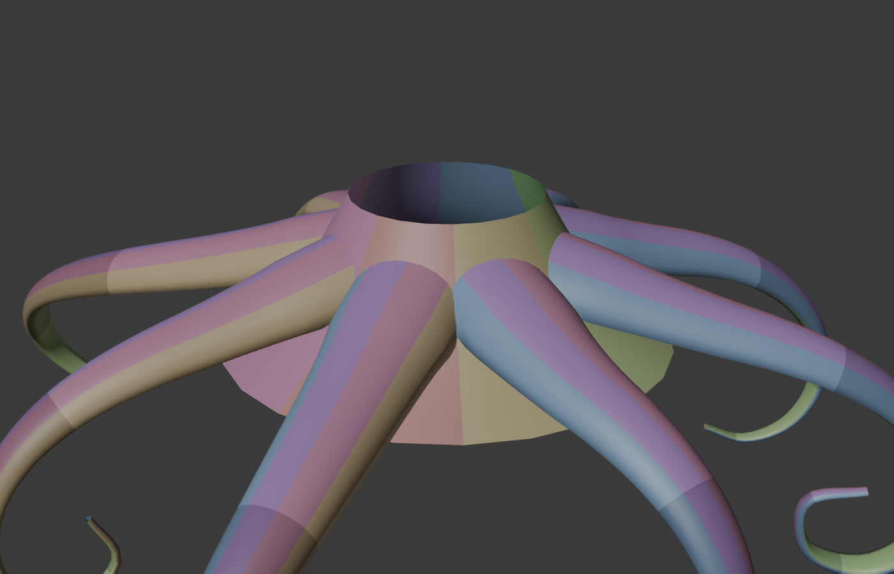

**What it does**

- **Poseable tentacles:** an IK bone chain with a tip handle and optional control points along the
  length. Spin a handle to twist; curl presets give a spiral to start from.
- **Shape controls:** length, base and tip width, taper, bulge, flare at the base, section height,
  and how flat the suction side is.
- **A funnel mount ring** that sits on the hoop skirt. The tentacles grow out of it, and each
  base is cut to fit the ring's curve.
- **Panels:** lengthwise strips (gores) split into pieces that fit your mats. **Suggest Panels** picks
  the fewest seams that keep every panel within what foam can stretch to.
- **Foam stock:** thick floor mats, stepping down to thinner sheets wherever a curl is too tight for
  thick foam to bend. Each stock gets its own cutting file.
- **Full-size cutting templates:** every mat or sheet laid out with its pieces nested, tiled onto
  US Letter (or A4) with numbered registration targets. Designed for a black-and-white laser printer.
- **Bevel angles on every angled cut,** a cross-section diagram beside each one, and a page of
  cut-out bevel gauges.
- **A costume material** (shiny faux PU leather or crushed velvet, with appliqué suckers) for renders.

## Install

1. Download `eva_tentacle-x.y.z.zip` from the [latest release](../../releases/latest).
2. In Blender (4.2 or newer): **Edit → Preferences → Get Extensions**, then the **⌄** menu at the
   top right, then **Install from Disk…**, and pick the zip.
3. The tools are in the 3D view sidebar (press **N**), on the **Tentacle** tab.

## How to make a tentacle costume

### 1. Set up your foam stock first

Open **Foam & PDF** and tell it what foam you have:

- **Foam thickness** and **Mat W / H:** your main stock. The defaults are 1 cm floor mats,
  56 × 56 cm. **Mat margin** is the unusable border, such as the interlocking teeth.
- **Thinner stock:** sheets for the tight parts. The default is 5 mm sheets, 35 × 59 in. **Add Stock**
  adds one more row, such as 2 mm for the very tips. Only the stocks listed here are used.
- **Bend limit:** foam bends badly once it's thicker than about a quarter of the bend radius,
  so the default is 4.

### 2. Add the tentacles

- **Mount Ring** adds the funnel ring. With it selected, set its top and bottom widths, the height of
  each edge above the floor, the profile curve, and whether it's oval.
- The **Ursula set** box adds a whole set (8 by default) standing on the ring, each with its own
  curl. **Tentacle** adds just one.

### 3. Pose them

- Drag the **sphere at the tip** to place the end. Rotate it to aim the tip.
- **Control points** adds arrow handles along the length, to place the middle.
- **Spin a handle** around the tentacle's length (R, Y, Y) to twist that stretch.
- **Curl Tentacle** sets a spiral curl you can then tweak with the handles.
- **Keep pose** stores the pose in the bones, so you can rotate single bones in Pose Mode.
- **Mount:** **Around** sets the angle around the ring, **Down the ring** how far down it sits, and
  **Lift off** how steeply it leaves the ring.
- **Copy to Selected** copies one tentacle's settings to the others you've selected.

### 4. Shape and panels

- **Shape:** widths, taper, bulge, flare, section height, and **Suction side roundness**
  (0 = a flat underside with crisp corners).
- **Panels:** **Top gores** and **Suction gores** are the lengthwise strips. **Facets** are flat steps
  across each strip: 1 makes flat panels with bevelled seams; 3 or more makes curved panels you
  heat-form, with square seams.
- Press **Suggest Panels**. It tries different gore counts on your actual poses and picks the fewest
  seams that keep every panel under the stretch limit (3% heat-forms easily).
- **Live preview** colours each piece on the 3D model a moment after you stop editing.

### 5. Export

1. Set **Paper** (US Letter tiles by default), **Mats** (*Shared* nests every tentacle together for
   the least waste), and a **Folder**.
2. Optionally press **Optimise Pieces for Mats**, which tries shorter piece lengths and keeps whichever
   needs the fewest mats.
3. Select the tentacles and ring (or set Export to **All**), then press **Export Pattern PDFs**.

You get:

- **One cutting file per foam stock,** e.g. `Cut_all_7_10mm_mats_560x560.pdf`. Page 1 shows every mat
  at a glance. Then comes a page of bevel gauges, then each mat full size, split across letter
  sheets.
- **One PDF per tentacle** (and the ring): settings, cross-section, panel map, assembly steps, and
  which mat each piece is on.

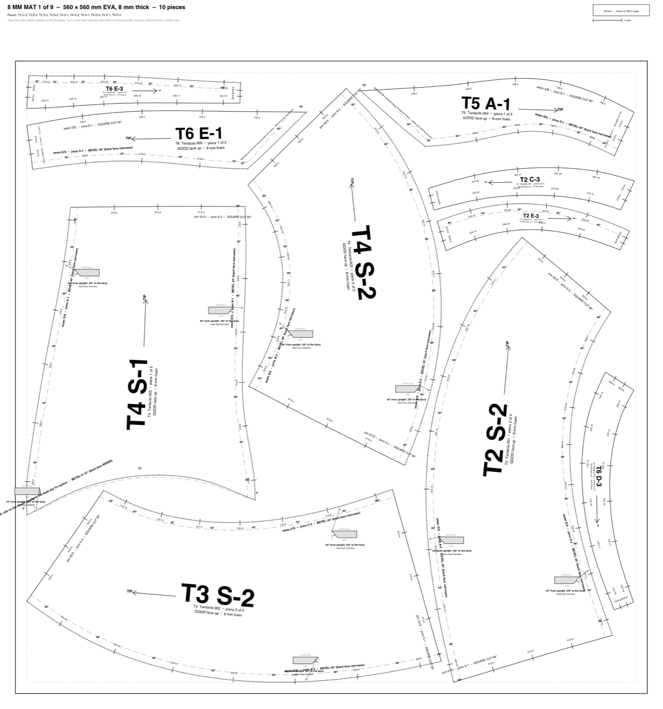

### 6. Print and cut

1. **Print at 100% / actual size.** Check the 50 mm box and the 1 inch line on the page.
2. **Tape the sheets together:** each mat's sheets overlap by 18 mm. Lay them so the numbered
   **R** targets sit exactly on top of each other, then tape.
3. **Stick the template on the smooth side of the foam** with **Odif temporary adhesive spray**
   (most fabric stores carry it), with the solid outer frame on the edges of the mat or sheet.
   The smooth side is the good face, the side that faces out on the costume, and the patterns are
   drawn for it. (With *Mirror for back face* on, they're flipped for the textured back instead.)
   Cut straight through the paper. It peels off during or after gluing, and until then every piece
   keeps its label and marks.
4. **Cut every piece,** reading the lines:

| On the pattern | Meaning |
|---|---|
| Solid line | Cut straight down (90°). These seams glue into a smooth, rounded join. |
| Heavy dotted line | Bevel cut. The bold number beside it is how far to tilt the blade **from upright**. |
| Grey long dashes | Where a bevel comes out on the back face. |
| Black ticks with codes | Match marks. Nick them or mark them on the foam. |
| Shaded / hatched cells | Heat and stretch / heat and gather the foam there (darker = more). |
| Dash-dot outline | On the ring: where a tentacle base is glued. |
| Faint dots | Forming lines: curve the foam across them. |

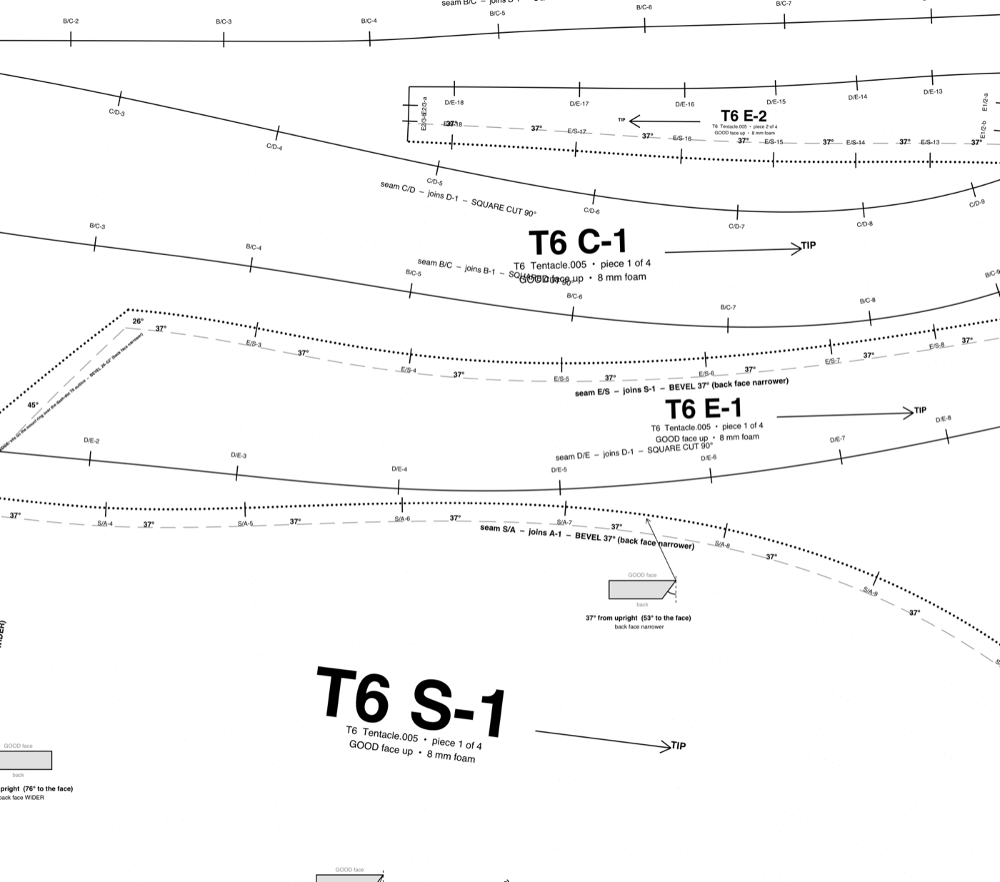

<p align="center">
  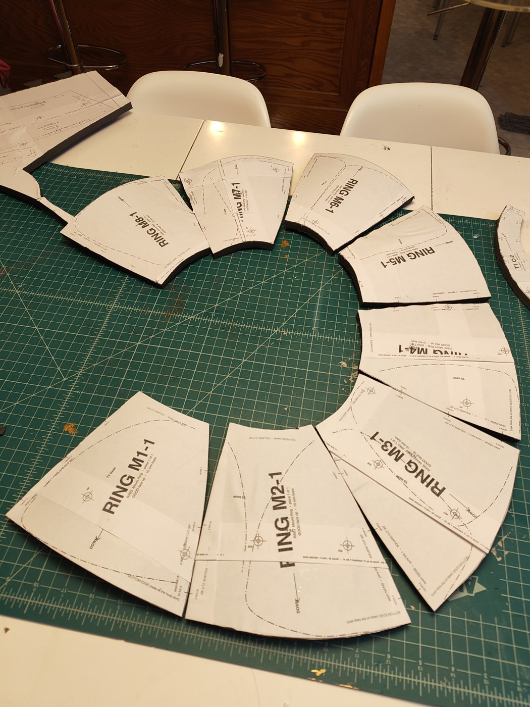
  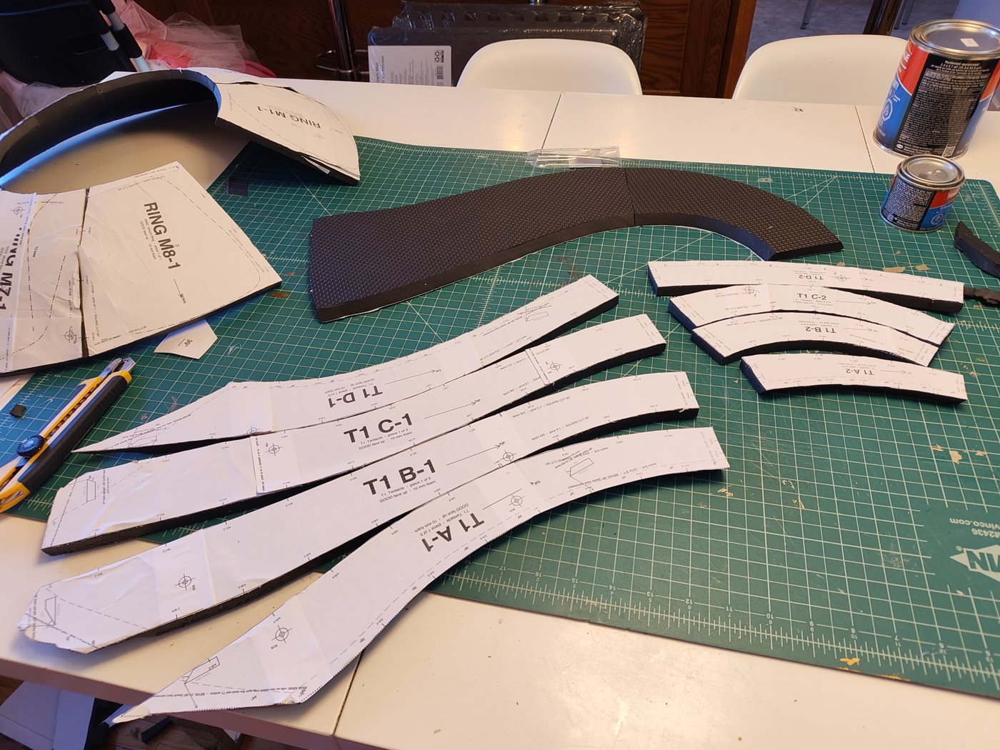
</p>
<p align="center"><i>Ring panels M1–M8 and a tentacle's pieces, cut with the paper templates still on.
Leave the template on until you glue, so every piece keeps its label.</i></p>

**Bevels:** 30° means the blade leans 30° from upright, so the cut face makes 60° with the good face.
"Back face narrower" means it leans in under the piece; "back face WIDER" means the other way.
Print the **bevel gauges** page, glue it to card and cut the gauges out. Stand one on the foam's good
face beside the line, and tilt the blade until it lies along the gauge's slanted edge. There's one
gauge for every angle printed in that file.

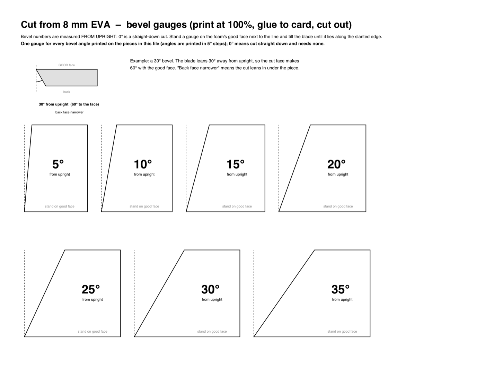

### 7. Assemble

1. **Heat-form** each panel along its forming lines, so it already has the curve of the section.
   Warming a panel with a heat gun just before you join it also makes it more flexible, so it bends
   into place without fighting you.
2. **Join the pieces of each strip end to end** (A-1 + A-2 …). The join ticks `A1/2-a`, `A1/2-b` line up.
3. **Glue the strips side by side,** matching seam ticks: `A/B-3` on one panel meets `A/B-3` on the next.
4. **Close the last seam** (between the suction strip and strip A).
5. **Glue each base onto the ring** over its dash-dot outline. The base edges are already cut at the
   angle that sits flat on the ring.

**Glue: LePage Heavy Duty Contact Cement** works best. Follow the instructions on the container:
brush both edges, wait until the cement is tacky, then press them together.

> **You get one shot.** Contact cement bonds the moment the two surfaces touch, and they can't be
> pulled apart and repositioned. Before the edges meet, line up the **outer (good) surfaces** so
> they're flush, start from a match mark, and work along the seam.

<p align="center">
  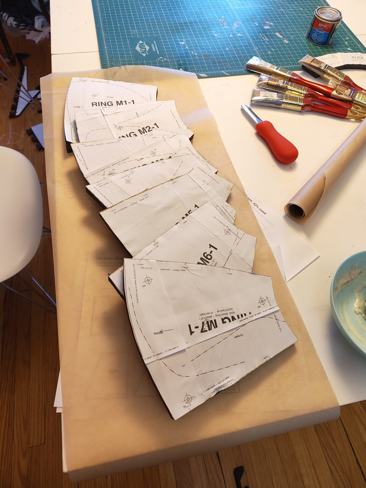
  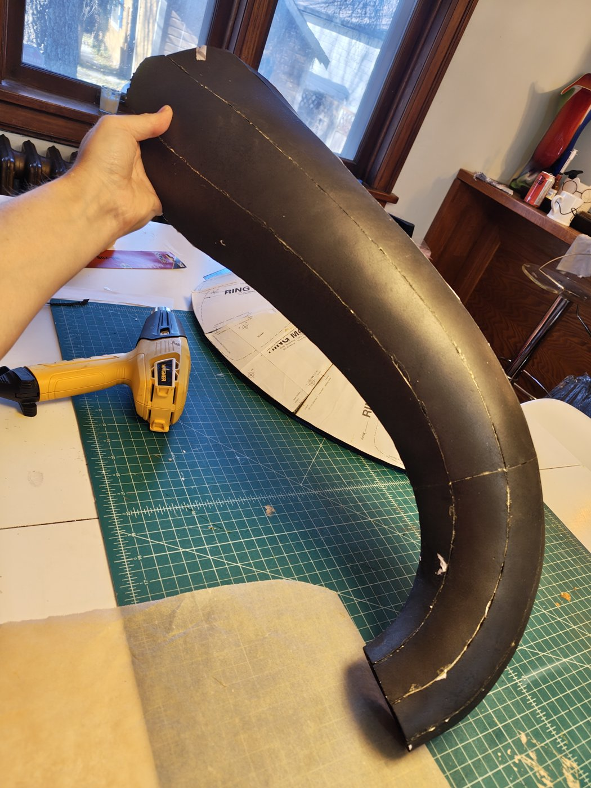
  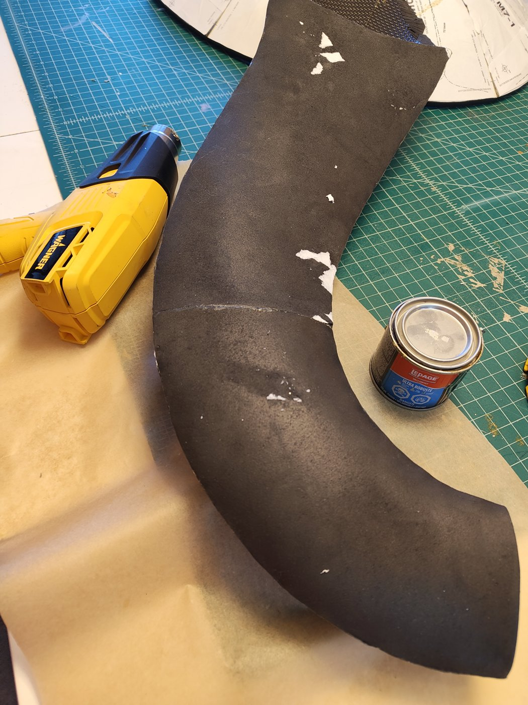
</p>
<p align="center"><i>Ring pieces ready for cement; a glued tentacle section holding its curve with only
square seams; heat-forming the underside of the curl.</i></p>

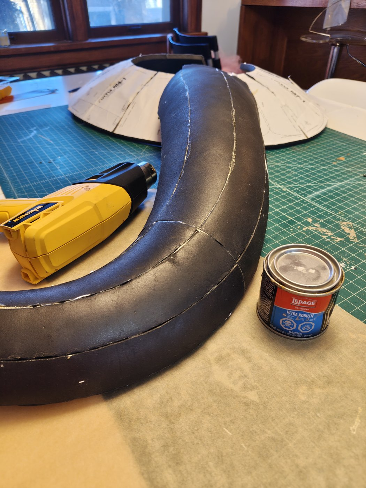

## Rendering

**Apply Ursula Fabric** (Shape panel) puts a costume material on the tentacles: shiny plum-black
faux PU leather with a pebbled grain (or crushed velvet), and padded suckers in two staggered rows
underneath that shrink toward the tip. It follows any pose, and renders in Cycles.

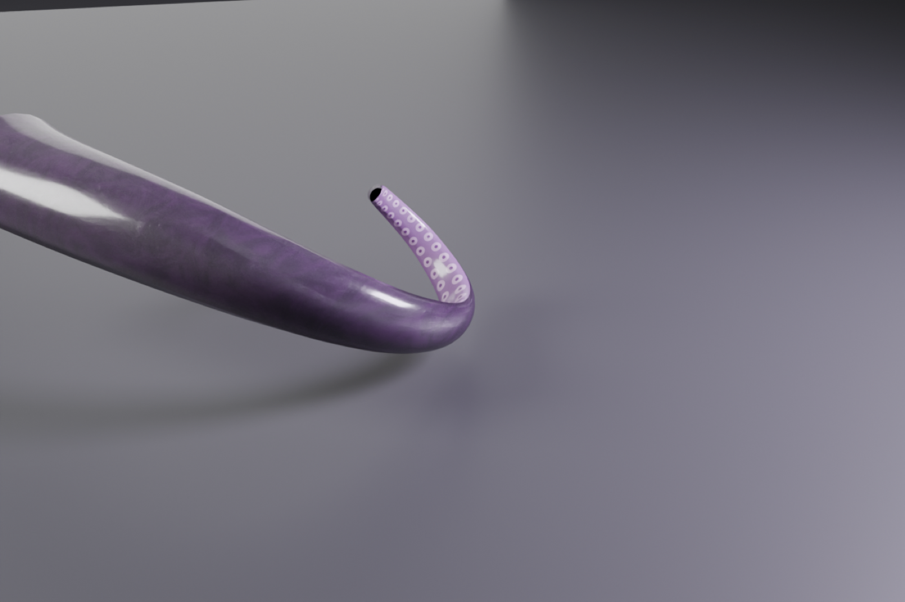

## Tips and warnings

- **"has to stretch ~N%":** a wide, curved panel on a tight curl can't lie flat. Add gores, or let
  it be cut shorter (*Max stretch*).
- **"Even 5 mm foam is too thick from … mm along":** the curl there is tighter than your thinnest
  stock can bend. Add a thinner stock, or ease the curl.
- **"Curl too tight":** the curl is tighter than the tentacle is thick, so the inside folds through
  itself. Ease it.
- **Mats per tentacle:** set **Mats** to *Per tentacle* to keep each tentacle's pieces on their own mats.
- **Mirror for back face:** flips the patterns, if you trace onto the back of the foam.

## For developers

`geometry.py` (sweep, fold angles, splitting, flattening) and `pdfgen.py` / `pattern_pdf.py`
(the PDF writer and layouts) don't need Blender:

```bash
cd tests && python3 test_geometry.py && python3 make_test_pdf.py /tmp/t.pdf LETTER
blender -b --factory-startup --python tests/test_blender.py -- /tmp/eva_out
blender --command extension build --source-dir eva_tentacle --output-dir dist
```

Licensed under the GPL-3.0-or-later (see `LICENSE`).
